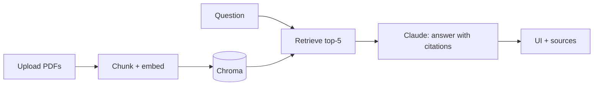

# Lesson 17: Put Your Projects on GitHub + Portfolio

*Month 3, Week 12. Reading time: about 55 minutes, then 3–5 days of polishing. Assumes Lessons 03, 05, 11 and 16.*

---

## 🛠️ Setup for this lesson

| You need | Why | How to get it |
|---|---|---|
| **Git** + **GitHub CLI**, logged in | Polish and publish your repos | Setup Guide Step 6; `gh auth status` |
| A repo named `<username>.github.io` | Your free portfolio site on GitHub Pages | Setup Guide Step 13 |
| A screen recorder | Demo GIFs and a 2-minute walkthrough video | Mac: `Cmd+Shift+5` · Windows: Snipping Tool (record) or the free ScreenToGif · any OS: OBS Studio (obsproject.com) |
| *Markdown Preview Mermaid Support* (optional) | Preview the architecture diagrams in your READMEs | VS Code Extensions panel |
| LinkedIn profile (optional) | Share your projects | linkedin.com |

**Install:**

```bash
gh auth status
# create your portfolio site repo
cd ~/ai-engineer-projects
mkdir <your-username>.github.io && cd <your-username>.github.io
git init
gh repo create <your-username>.github.io --public --source=. --remote=origin
```

**Check it works:**

```bash
gh repo view --web          # opens the repo in your browser
# After pushing index.html: Settings → Pages → Deploy from a branch → main
# Then visit https://<your-username>.github.io
```

Stuck? See the step-by-step instructions and the troubleshooting table in [`00_SETUP_Install_Guide.md`](../../00_SETUP_Install_Guide.md).

---

## 1. The big picture

### What is this, in simple words?

You've built a lot in 12 weeks. But to an employer, a collaborator or a client, **work they can't see or understand quickly doesn't exist.** This final lesson is about presentation:

- **GitHub** is where your code lives publicly (Lesson 03). A well-organised GitHub profile shows *how* you work.
- A **portfolio** is a curated showcase of your best projects, explained for humans: what problem each solves, what you built, how well it works, and what you learned. It can be a simple website, your GitHub profile page, or both.

Analogy: an artist doesn't hand a gallery a box of every sketch they've ever made. They choose their best 3–5 pieces, frame them, light them well, and put a short card next to each explaining it. Your GitHub is the studio full of work; your portfolio is the gallery wall.

### Which field does it belong to?

This is **career development / professional communication** for software and AI engineers. It also uses **technical writing**: explaining technical work clearly to different audiences.

### Why does it matter?

| Fact of hiring | What it means for you |
|---|---|
| Reviewers spend **seconds to a couple of minutes** on a profile or repo | Your best work and its value must be obvious immediately |
| For career changers and new graduates, **projects are the experience** | A strong portfolio can substitute for job titles |
| AI engineering is new, so many applicants list the same courses | **Deployed, evaluated, documented** projects stand out sharply |
| Interviews often start with "walk me through a project" | Clear write-ups double as interview preparation |

> **In simple words:** A portfolio turns your projects into clear, visible proof of skill. GitHub shows the code and how you work; the portfolio explains the value in a minute. Presentation is the last, essential step of building.

---

## 2. Core concepts

### 2.1 Your audiences

| Audience | Time they give you | What they look for |
|---|---|---|
| **Recruiter** (often non-technical) | 30–60 seconds | Clear titles, one-line descriptions, live demos, keywords (Python, LLMs, RAG, LangGraph, FastAPI, Docker) |
| **Hiring manager** | 2–5 minutes | Real problems, results with numbers, good judgement, communication |
| **Engineer reviewing your code** | 5–15 minutes | Structure, tests, README, commit history, how you handle errors, secrets and evals |
| **Interviewer** | 30–60 minutes | Depth: trade-offs, failures, what you'd change |

Design for the fastest reader first (the top of every page), with depth available for those who dig.

### 2.2 The GitHub profile

| Element | What to do |
|---|---|
| **Profile photo, name, bio** | A clear photo; bio like "AI engineer: RAG, agents, LLM evals. Python · FastAPI · LangGraph." |
| **Profile README** | Create a public repo named exactly your username (`yourname/yourname`); its README.md appears on your profile page. Use it as a mini-portfolio. |
| **Pinned repositories** | Pin your best **4–6** projects (Profile → Customize your pins). Most visitors only see these. |
| **Contribution graph** | Steady activity looks good, but never fake it; quality beats green squares. |
| **Links** | Portfolio site, LinkedIn, email. |

### 2.3 Repository hygiene

Every pinned repo should have:

| Item | Why |
|---|---|
| **Clear name** (`studybuddy-rag`, not `project3`) | Instantly understandable |
| **About description + website link** (the gear icon on the repo page) | Shown in pins and search |
| **Topics/tags** (`rag`, `llm`, `langgraph`, `fastapi`) | Discoverability, keywords |
| **Excellent README** (2.4) | The main thing people read |
| **License** (e.g. MIT) | Says others may use your code; looks professional |
| **`.gitignore`, `.env.example`**, no secrets | Security and professionalism |
| **Tests + CI badge** | Shows engineering discipline |
| **Clean history** | Meaningful commit messages (Lesson 03); no "asdf" commits on main |
| **Releases/tags** (optional) | `v1.0` marks a finished version |

Clean out or archive weak repos: unfinished tutorial copies dilute your best work. You can make them private or **archive** them (Settings → Archive).

### 2.4 The project README that gets read

Use a consistent structure (you started this in Lesson 05):

~~~markdown
# StudyBuddy 📚: chat with your notes and quiz yourself

> Upload course notes → ask questions with cited answers → generate practice quizzes.
> **[Live demo](https://...)** · **[2-min video](https://...)** · Python · Claude API · Chroma · Streamlit


## Why
Students lose time searching long notes and rarely self-test. StudyBuddy answers from *their*
notes only, with sources, and turns any topic into a quiz.

## Results
| Metric (30-question eval) | Score |
|---|---|
| Answer correctness | 88% |
| Faithfulness (LLM judge) | 94% |
| Correct "not in your notes" | 100% |
| Cost per question | $0.004 |

## How it works


## Key decisions
- Heading-prefixed chunks: +8% retrieval hit rate (v1 → v2).
- Low effort for Q&A, medium for quiz generation: cost vs quality from the eval.
- Code-level quiz validation (4 distinct options) on top of structured outputs.

## Run locally
    git clone ... && cd studybuddy
    cp .env.example .env   # add ANTHROPIC_API_KEY
    uv sync && uv run streamlit run app.py

## Limitations & next steps
- Scanned PDFs without text aren't supported (no OCR yet).
- Single-user; no accounts.
- Next: hybrid search, spaced-repetition scheduling.

## What I learned
Evals changed my mind twice: ...
~~~

The top five lines (title, one-liner, links, tech, screenshot) must work on their own: that's all most visitors read. **Results with numbers** are what separate AI-engineering projects from tutorial copies.

**Mermaid** diagrams (Lesson 14) render directly on GitHub. GIFs can be recorded with free tools (e.g. the OS screen recorder + a GIF converter, LICEcap, Kap, or ScreenToGif).

### 2.5 The portfolio site

Not required, but valuable: one link that shows everything.

| Option | Effort | Notes |
|---|---|---|
| **Profile README only** | Lowest | Good enough to start |
| **GitHub Pages** | Low | Free hosting for a static site from a repo (`username.github.io`) |
| **A simple site** (static HTML, or a site builder, or a template) | Low–medium | Use a clean template; content matters more than design |
| **Notion / Read.cv-style pages** | Low | Quick, but less "engineer-y" |

Structure:

1. **Header:** name, one-line positioning ("I build reliable LLM applications: RAG, agents, evals"), links.
2. **3–5 featured projects** as **cards**: title, one-liner, screenshot, 2–3 result bullets, tech tags, links (demo / code / write-up).
3. **Skills** (grouped, honest): Languages · LLM/AI · Data · Backend/DevOps.
4. **About:** 3–4 sentences of your story (career changers: your previous field is a *strength*: "former accountant → AI for finance ops").
5. **Writing** (optional): blog posts.
6. **Contact.**

### 2.6 Case studies: telling the story of a project

For your top 1–2 projects, write a short **case study** (a blog post or portfolio page, 600–1,200 words):

| Section | Content |
|---|---|
| **Problem** | Who, what pain, why it matters |
| **Constraints** | Budget, latency, data, privacy |
| **Approach** | Architecture, key decisions and *why* (single call vs workflow vs agent; RAG vs long context) |
| **What went wrong** | Failures and how you found them (evals!), the most interesting part to readers |
| **Results** | Metrics, before/after tables, cost |
| **Next** | What you'd do with more time |

This is the same structure interviewers want when they say "walk me through a project."

### 2.7 Demo videos

A 2–3 minute video gets watched far more than code gets read. Structure: **problem (15 s) → live demo (60–90 s) → architecture (30 s) → results/evals (20 s) → what you'd improve (15 s).** Record with your OS's screen recorder, OBS, or Loom; upload to YouTube (unlisted is fine) or Loom; link it at the top of the README.

### 2.8 Sharing your work

| Channel | How |
|---|---|
| **LinkedIn** | A post per project: the problem, a GIF, one surprising lesson, the link. Short, human, specific. |
| **Blog** (your site, dev.to, Hashnode, Medium) | Case studies and "what I learned" posts. |
| **Communities** | Reddit (r/learnmachinelearning, r/LocalLLaMA, r/Python), Discord servers, local meetups; ask for feedback, not likes. |
| **Hugging Face Spaces** | Demos are discoverable by the ML community. |

### 2.9 Open-source contributions

Contributing to existing projects shows you can read others' code and collaborate:

1. Pick a tool you actually used (a LangChain integration, an MCP server, a docs site).
2. Look for issues labelled **"good first issue"** or **"help wanted."**
3. Start small: fix docs, add an example, add a test, fix a small bug.
4. Read `CONTRIBUTING.md`, follow the style, open a clear pull request (Lesson 03).

Even one merged PR in a known project is a great talking point.

### 2.10 From projects to CV bullets

Turn each project into 1–2 **impact bullets** using the pattern: **Accomplished [X] as measured by [Y] by doing [Z].**

| ❌ Weak | ✅ Strong |
|---|---|
| "Made a chatbot with LangChain." | "Built and deployed a RAG assistant over a 40-page HR handbook (FastAPI, Claude, Docker); 94% faithfulness on a 30-question eval at $0.004/question." |
| "Learned about agents." | "Designed a LangGraph support workflow (parallel guardrail check, routing, reviewer loop, human approval) that drafted policy-correct replies for 90% of test emails." |
| "Used GitHub Actions." | "Automated a daily AI news digest on GitHub Actions (RSS → structured LLM selection → Slack) with failure alerts and dedup." |

Use real numbers from your evals and logs. Never invent metrics.

### 2.11 Interview preparation with your portfolio

Prepare a **2-minute** and a **10-minute** walkthrough for each featured project, and answers to the questions AI-engineering interviewers commonly ask:

| Question | What they're checking |
|---|---|
| "How do you know it works?" | Evals, metrics, test sets |
| "What was the hardest bug?" | Debugging skill, honesty |
| "Why RAG / an agent / LangGraph here?" | Judgement: simplest approach that works |
| "How do you handle hallucinations / prompt injection?" | Safety and grounding (Lessons 07, 10, 12) |
| "What does it cost per request, and how would you cut it?" | Cost awareness (Lesson 08) |
| "What happens with 1,000 users?" | Rate limits, statelessness, async, scaling (Lesson 16) |
| "What would you change?" | Reflection and growth |

### 2.12 Honesty and ethics

- Only claim work you did. If you followed a tutorial, say so and show what you changed.
- Credit libraries, datasets and collaborators.
- Never publish real personal data, private company data, or API keys.
- Be clear about AI assistance in your workflow if asked; what matters is that you understand and can defend every line (Lesson 05).

> **In simple words:** Know your audiences and design for the 30-second reader. Polish your GitHub profile (bio, profile README, 4–6 pinned repos) and each repo (name, description, topics, license, README with results, CI, no secrets). Add a simple portfolio site, case studies, demo videos and posts. Contribute to open source, turn projects into metric-based CV bullets, prepare walkthroughs, and stay honest.

---

## 3. How it works: turning 12 weeks of work into a portfolio, start to finish

### Step 1: Inventory (1 hour)

List every project from the course and score it:

| Project | Lesson | Problem clarity | Deployed? | Evals? | Polish | Keep? |
|---|---|---|---|---|---|---|
| Expense Analyzer | 05 | ✓ | ✗ | tests | ok | supporting |
| Live Data Dashboard | 05 | ✓ | Streamlit | tests | ok | supporting |
| ML Predictor | 05 | ✓ | ✗ | CV metrics | ok | supporting |
| Support Triage | 07–08 | ✓ | ✗ | 25-case eval | good | merge into capstone |
| StudyBuddy | 11 | ✓✓ | Streamlit Cloud | 30-case eval | good | **featured** |
| Travel/Finance Agent | 12 | ✓ | ✗ | 10-case eval | ok | supporting |
| News Digest automation | 15 | ✓ | GitHub Actions | dry-run tests | good | **featured** |
| Capstone | 16 | ✓✓ | ✓ live | 30+ eval | great | **featured #1** |

Rule: **3–4 featured projects** that together show breadth (data/ML, RAG, agents/workflows, automation, deployment). Everything else is "supporting" or archived.

### Step 2: Fix the basics on every featured repo (half a day)

For each featured repo, run this checklist:

- [ ] Descriptive name and About description with live link
- [ ] Topics: `llm`, `rag`, `python`, `fastapi`, `langgraph`, etc.
- [ ] README in the 2.4 structure, top 5 lines strong
- [ ] Screenshot or GIF in `docs/`
- [ ] Results table from your real evals
- [ ] Mermaid architecture diagram
- [ ] `LICENSE` (GitHub: Add file → Create new file → name it `LICENSE` → choose a template)
- [ ] CI badge, tests passing
- [ ] `.env.example`; search history for leaked keys (`git log -p | grep -i "sk-ant"`); if anything leaked, **revoke the key** (Lesson 03)
- [ ] Fresh-clone test passes (Lesson 05)

### Step 3: Write the profile README (1 hour)

Create the repo `yourname/yourname` with:

```markdown
### Hi, I'm Asha 👋  AI engineer building reliable LLM applications

I build RAG systems, agentic workflows and automations, and I measure them with evals.
Previously: 4 years in finance operations, so I like automating painful processes.

**Featured**
- 🎓 **[Support Copilot](https://github.com/asha/support-copilot)**: LangGraph triage workflow with
  guardrails and human approval · 92% policy-correct drafts · [live](https://...)
- 📚 **[StudyBuddy](https://github.com/asha/studybuddy)**: chat with your notes + auto quizzes ·
  94% faithfulness · [live](https://...)
- 🗞️ **[AI News Digest](https://github.com/asha/news-digest)**: daily GitHub Actions automation →
  Slack · structured LLM curation

**Stack:** Python · Claude API · LangChain/LangGraph · Chroma/pgvector · FastAPI · Docker · GitHub Actions · Pandas · scikit-learn

📫 [Portfolio](https://asha.github.io) · [LinkedIn](https://linkedin.com/in/...) · asha@example.com
```

Pin the featured repos.

### Step 4: Build a one-page portfolio site on GitHub Pages (half a day)

1. Create a repo named `yourname.github.io`.
2. Add an `index.html` with your header, project cards, skills, about and contact (a simple template is in Practice 17).
3. Push. GitHub Pages serves it at `https://yourname.github.io` (check Settings → Pages if it doesn't appear).

### Step 5: Write one case study (half a day)

Pick your capstone. Write 800 words using the 2.6 structure. Include the eval table that shows improvement across versions and one honest failure ("the reviewer loop sometimes 'fixed' correct drafts into wrong ones; adding the policy text to the reviewer prompt cut this from 12% to 2%"). Publish on your site or a blog platform; link it from the README.

### Step 6: Record the demo video (2 hours)

Script it to the 2.7 structure, record two takes, keep the better one, upload, link it in README, profile README and portfolio.

### Step 7: Update your CV and LinkedIn (2 hours)

- Add a **Projects** section with 3–4 metric-based bullets (2.10).
- LinkedIn headline like the bio; Featured section with the live demos; one post about the capstone with the GIF.

### Step 8: Get feedback and iterate (ongoing)

Ask 2–3 people (one non-technical, one engineer) to look at your profile for 60 seconds and tell you what they remember. Fix whatever they missed. Then keep shipping: one small project or improvement per month keeps the profile alive.

### The whole process

```
 inventory & choose 3–4 featured ─▶ fix repo basics ─▶ profile README + pins ─▶ portfolio site
            │                                                                        │
            └──────── case study ─▶ demo video ─▶ CV & LinkedIn ─▶ feedback ─▶ keep shipping
```

> **In simple words:** List and score your projects, feature the best 3–4, polish each repo to a checklist, write a profile README and pin them, publish a one-page site, write one case study, record a demo video, update your CV and LinkedIn with metric-based bullets, then get feedback and keep shipping.

---

## 4. Key terms (in order)

| Term | Plain meaning |
|---|---|
| **Portfolio** | A curated showcase of your best work, explained for humans. |
| **Technical writing** | Explaining technical work clearly to a chosen audience. |
| **Profile README** | A README in a repo named after your username, shown on your profile. |
| **Pinned repositories** | The 4–6 repos you choose to feature on your profile. |
| **Contribution graph** | The grid of green squares showing activity. |
| **Repository description / topics** | Short About text / searchable tags on a repo. |
| **License (MIT)** | Terms saying how others may use your code. |
| **Badge** | A small status image in a README (e.g. CI passing). |
| **Release / tag** | A named, finished version of a project. |
| **Archive (a repo)** | Mark it read-only and de-emphasised. |
| **Mermaid** | Text-based diagrams that GitHub renders. |
| **GIF / demo video** | Short animation / 2–3 min walkthrough showing the app working. |
| **GitHub Pages** | Free hosting for static websites from a GitHub repo. |
| **Project card** | A compact block summarising one project on a portfolio page. |
| **Case study** | A short write-up of a project's problem, approach, failures and results. |
| **Good first issue** | Open-source label marking beginner-friendly tasks. |
| **CONTRIBUTING.md** | A project's guide for contributors. |
| **Impact bullet** | A CV line: accomplished X, measured by Y, by doing Z. |
| **Walkthrough** | A spoken explanation of a project for interviews. |

> **In simple words:** Profile, pins, README, site, case study, video, bullets, walkthrough.

---

## 5. The people involved

| Who | Role | What they need from your portfolio |
|---|---|---|
| **You** | Author | A clear story of what you can do and where you're heading. |
| **Recruiters** | First filter | Keywords, clarity, live links, in seconds. |
| **Hiring managers** | Decision makers | Real problems, judgement, results, communication. |
| **Engineers / interviewers** | Technical evaluation | Clean code, tests, evals, honest trade-offs. |
| **Clients** (if freelancing) | Buyers | Business outcomes: time saved, cost, reliability. |
| **Peers & mentors** | Feedback givers | Specific asks ("is my README's first screen clear?"). |
| **Open-source maintainers** | Collaborators | Small, well-made PRs that follow their guidelines. |

> **In simple words:** Different readers need different depth. Lead with value, back it with evidence, and be ready to go deep.

---

## 6. Common misconceptions and beginner mistakes

| Mistake | Fix |
|---|---|
| Pinning tutorial clones | Pin original, deployed, evaluated projects; archive the rest. |
| README = "My project. Run main.py." | Use the full structure: one-liner, demo, results, architecture, run steps, limitations. |
| No numbers anywhere | Add eval tables, cost per request, latency. |
| Demo link that's broken or asleep | Check links monthly; note cold starts; keep a video as backup. |
| Leaked keys in history | Scan history; revoke any exposed key immediately. |
| Listing every buzzword in skills | List what you've actually used in projects. |
| Waiting until "ready" to share | Ship, share, improve. |
| Gaming the contribution graph | Reviewers can tell; focus on meaningful work. |
| Overclaiming ("built an AGI agent") | Precise, honest descriptions build trust. |
| Fancy site, weak content | Content first; a plain clean page is fine. |
| Not practising the walkthrough | Rehearse 2- and 10-minute versions out loud. |

> **In simple words:** Fewer, better, deployed, measured, honest, and rehearsed.

---

## 7. One-page recap

### The 10 things to remember

1. **Unseen work doesn't exist.** Presentation is part of building.
2. **Design for the 30-second reader;** offer depth for the 30-minute one.
3. **Profile:** clear bio, profile README, 4–6 pinned repos.
4. **Repo hygiene:** name, description, topics, license, CI badge, `.env.example`, no secrets.
5. **README top 5 lines** = title, one-liner, live demo + video, tech, screenshot.
6. **Results with numbers** (evals, cost, latency) make AI projects credible.
7. **A simple portfolio site** with 3–5 project cards (GitHub Pages is free).
8. **Case study + demo video** for your top project.
9. **Metric-based CV bullets;** rehearsed 2- and 10-minute walkthroughs.
10. **Keep shipping and stay honest.**

### 🎉 Congratulations: what to learn next

You've completed all three months: Python and data → ML → LLMs, prompting, APIs, embeddings and RAG → agents, workflows, frameworks, automation, deployment and portfolio. Take `../Month3_Final_Test.md`, then choose a direction:

| Direction | Learn next |
|---|---|
| **Deeper AI engineering** | Advanced evals (statistics, A/B tests), observability, cost optimisation, multi-agent systems, MCP server design |
| **ML depth** | Deep learning with PyTorch, the transformer in detail (Karpathy's "Neural Networks: Zero to Hero"), fine-tuning small open models (LoRA) |
| **Data engineering** | SQL in depth, Postgres, data pipelines (Airflow/Dagster), Polars, dbt |
| **Full-stack** | TypeScript, React/Next.js, auth, payments; build complete AI products |
| **Domain specialisation** | Apply AI to the field you know (finance, health, law, education); domain + AI is a powerful combination |
| **Safety & reliability** | Red-teaming, prompt-injection defence, AI governance and regulation (EU AI Act) |
