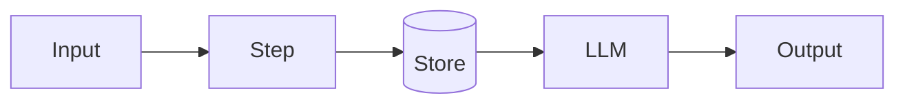

# Practice & Test 17: GitHub + Portfolio

> **🛠️ Before you start:** you need Git + `gh` logged in, a `<username>.github.io` repo, a screen recorder (`Cmd+Shift+5` on Mac, Snipping Tool/ScreenToGif on Windows, OBS anywhere). Install them with the commands in the **🛠️ Setup for this lesson** box at the top of [`lesson.md`](lesson.md) (full help: [`00_SETUP_Install_Guide.md`](../../00_SETUP_Install_Guide.md)). Quick check:
>
> ```bash
> gh auth status
> ```

This file contains: exercises, ready-to-use templates (repo README, profile README, portfolio page, case study, CV bullets, interview prep), a final checklist, and a quiz.

---

## Part A: Exercises

**A1. The 60-second test.** Open your GitHub profile in a private/incognito window. Set a 60-second timer. Afterwards, write down what a stranger would remember. Is it what you want them to remember?

**A2. Rewrite these weak bullets** into impact bullets (accomplished X, measured by Y, by doing Z), using numbers from your own projects:
1. "Made a RAG chatbot."
2. "Used LangGraph."
3. "Built an automation with GitHub Actions."
4. "Did data cleaning with Pandas."
5. "Trained a machine learning model."

**A3. README audit.** For each featured repo, score 0–2 on: one-liner, demo link, screenshot/GIF, results with numbers, architecture diagram, run steps that work, limitations, license, CI badge, no secrets. Fix anything below 2.

**A4. Topics & descriptions.** Add About descriptions, website links and 4–8 topics to each featured repo.

**A5. Secret scan.** In each repo run `git log -p | grep -iE "sk-ant|api_key|secret|password"`. Investigate every hit. If a real key ever appeared, **revoke it** at the provider, even if you deleted it later.

**A6. Elevator pitches.** Write a 2-sentence description of each featured project for a non-technical friend. Test it on one.

**A7. Walkthroughs.** Record yourself (phone is fine) giving a 2-minute walkthrough of your capstone. Watch it back. Re-record once.

**A8. Mock interview.** Have a friend (or an AI assistant playing interviewer) ask you the 7 questions in Lesson 17 Section 2.11 about your capstone. Write down any you struggled with and prepare better answers.

**A9. Open source.** Find 3 "good first issue" tickets in tools you used this course (e.g. an MCP server repo, a LangChain integration, a docs site). Pick one and open a PR, or at least comment to ask if it's still available.

**A10. Share.** Write and publish one LinkedIn (or blog) post about your capstone: problem, GIF, one surprising lesson from your evals, link.

---

## Part B: Templates

### B1. Project README template

~~~markdown
# <Project name> <emoji>: <what it does in 8 words>

> <One sentence: who it's for and the outcome.>
> **[Live demo](URL)** · **[Video](URL)** · <Tech 1> · <Tech 2> · <Tech 3>


## Why
<2–3 sentences: the problem and who has it.>

## Results
| Metric (<N>-case eval) | v1 | v2 | v3 |
|---|---|---|---|
| <quality metric> | | | |
| <safety/abstention metric> | | | |
| Cost per request | | | |
| p95 latency | | | |

## How it works


## Key decisions
- <Decision> because <evidence>.
- <Why single call / workflow / agent>.

## Run locally
```bash
git clone <url> && cd <repo>
cp .env.example .env    # add keys
uv sync && <run command>
```

## Tests & evals
```bash
uv run pytest          # unit tests, LLM mocked
uv run python evals/run_evals.py   # costs ~$<x>
```

## Limitations & next steps
- <Honest limitation>
- <Next improvement>

## What I learned
<2–4 sentences.>

## License
MIT
~~~

### B2. Profile README template

```markdown
### Hi, I'm <Name> 👋 <positioning line, e.g. "AI engineer building reliable LLM apps">

<One sentence on what you build + one on your background/angle.>

**Featured**
- <emoji> **[<Project>](<repo>)**: <what it is> · <one metric> · [live](<url>)
- <emoji> **[<Project>](<repo>)**: <what it is> · <one metric> · [live](<url>)
- <emoji> **[<Project>](<repo>)**: <what it is> · <one metric>

**Stack:** Python · <LLM APIs> · <frameworks> · <data/DB> · <deploy tools>

**Currently learning:** <topic>

📫 [Portfolio](<url>) · [LinkedIn](<url>) · <email>
```

### B3. One-page portfolio site (GitHub Pages)

Save as `index.html` in a repo named `<username>.github.io`:

```html
<!doctype html>
<html lang="en">
<head>
<meta charset="utf-8"><meta name="viewport" content="width=device-width, initial-scale=1">
<title>Your Name · AI Engineer</title>
<style>
  :root { --fg:#18181b; --muted:#52525b; --bg:#ffffff; --card:#f4f4f5; --accent:#2563eb; }
  @media (prefers-color-scheme: dark) { :root { --fg:#f4f4f5; --muted:#a1a1aa; --bg:#09090b; --card:#18181b; } }
  body { font-family: system-ui, sans-serif; color: var(--fg); background: var(--bg);
         max-width: 860px; margin: 0 auto; padding: 2rem 1rem; line-height: 1.55; }
  a { color: var(--accent); } .muted { color: var(--muted); }
  .grid { display: grid; gap: 1rem; grid-template-columns: repeat(auto-fit, minmax(250px, 1fr)); }
  .card { background: var(--card); border-radius: 12px; padding: 1rem; }
  .card img { width: 100%; border-radius: 8px; }
  .tags span { display: inline-block; font-size: .8rem; padding: .1rem .5rem; margin: .1rem;
               border-radius: 999px; background: var(--bg); }
</style>
</head>
<body>
  <header>
    <h1>Your Name</h1>
    <p>I build reliable LLM applications: RAG, agentic workflows and automations, measured with evals.</p>
    <p><a href="https://github.com/you">GitHub</a> · <a href="https://linkedin.com/in/you">LinkedIn</a> ·
       <a href="mailto:you@example.com">Email</a></p>
  </header>

  <h2>Projects</h2>
  <div class="grid">
    <article class="card">
      
      <h3>Support Copilot</h3>
      <p>LangGraph workflow that triages support email, drafts policy-correct replies, and waits for human approval.</p>
      <ul><li>92% policy-correct drafts (40-case eval)</li><li>$0.006 per email</li></ul>
      <p class="tags"><span>LangGraph</span><span>Claude API</span><span>FastAPI</span><span>Docker</span></p>
      <p><a href="#">Live demo</a> · <a href="#">Code</a> · <a href="#">Case study</a></p>
    </article>
    <!-- copy the card for 2–4 more projects -->
  </div>

  <h2>Skills</h2>
  <p><b>Languages:</b> Python, SQL · <b>AI:</b> LLM APIs, prompt engineering, RAG, embeddings, agents, evals ·
     <b>Frameworks:</b> LangChain/LangGraph, FastAPI, Streamlit · <b>Data:</b> Pandas, NumPy, scikit-learn ·
     <b>Ops:</b> Git/GitHub, Docker, GitHub Actions, Postgres/pgvector</p>

  <h2>About</h2>
  <p class="muted">3–4 sentences: your background, why AI, what you want to build next.</p>
</body>
</html>
```

### B4. Case study outline

```markdown
# <Project>: <hook, e.g. "How evals saved my support bot from confident mistakes">
**TL;DR:** <2 sentences with the key result.>

## The problem   (who, what pain, why it matters)
## Constraints    (budget, latency, data, privacy)
## Approach       (diagram; key decisions and why)
## What went wrong (the most interesting failures and how evals revealed them)
## Results        (before/after table; cost; latency)
## What I'd do next
```

### B5. CV "Projects" section template

```
PROJECTS
<Project name> | <Tech, Tech, Tech> | <live link> · <GitHub link>
• <Accomplished X> measured by <Y> by doing <Z>.
• <Second bullet: a design decision or engineering practice with evidence>.
```

### B6. Interview prep sheet (fill one per featured project)

| Question | My answer (bullet points) |
|---|---|
| 30-second summary | |
| Why this problem? | |
| Architecture in 3 sentences | |
| Why this pattern (call/workflow/agent) and these tools? | |
| How do you know it works? (evals + numbers) | |
| Hardest bug and how you found it | |
| Hallucination & prompt-injection handling | |
| Cost per request and how to cut it | |
| What breaks at 1,000 users? | |
| What would you change? | |

---

## Part C: Final portfolio checklist

**Profile**
- [ ] Photo, name, bio with positioning and stack
- [ ] Profile README (B2) with 3+ featured projects and links
- [ ] 4–6 pinned repos; weak repos archived or private

**Each featured repo**
- [ ] Clear name, About description, website link, topics
- [ ] README per B1: top 5 lines strong, results table with real numbers, diagram, run steps, limitations
- [ ] GIF/screenshot; demo video linked
- [ ] License, `.gitignore`, `.env.example`, CI badge (green)
- [ ] Secret scan clean; fresh-clone test passes
- [ ] Live link works (checked this week)

**Beyond GitHub**
- [ ] Portfolio site live (B3)
- [ ] One case study published (B4)
- [ ] CV projects section with metric-based bullets (B5)
- [ ] LinkedIn headline, Featured section, one project post
- [ ] Interview prep sheets done (B6), walkthrough rehearsed out loud
- [ ] At least one open-source contribution attempted

---

## Part D: Quiz (15 minutes)

1. How many repos should you typically pin?
   a) 1 b) All of them c) 4–6 of your best d) None

2. Where does a profile README live?
   a) A public repo named exactly your username b) A gist c) Your website only d) Any repo

3. The most important part of a project README is:
   a) The commit history b) The license text c) The folder tree d) The top few lines: title, one-liner, demo link, tech, screenshot

4. What makes an AI project stand out most to reviewers?
   a) A long README with no structure b) Deployment + evals with real numbers + clear documentation c) Lots of repos d) Many buzzwords

5. A good impact bullet follows:
   a) A paragraph of feelings b) A list of libraries only c) Accomplished X, measured by Y, by doing Z d) "Did stuff with AI"

6. If you find an old API key in your Git history you should:
   a) Make the repo private and forget it b) Delete the last commit only c) Ignore it d) Revoke/rotate it at the provider immediately

7. GitHub Pages is:
   a) Free static-site hosting from a GitHub repo b) A CI tool c) A code editor d) A paid CMS

8. A case study should include:
   a) Only successes b) Problem, constraints, approach, failures, results and next steps c) Only screenshots d) Only code

9. For "good first issue" contributions you should first:
   a) Rewrite the project b) Read CONTRIBUTING.md and check the issue is available c) Open a huge PR d) Email the maintainer daily

10. The best response to "How do you know it works?" is:
    a) "The model is very smart" b) "It looked good when I tried it" c) Describe your eval set, graders and metrics across versions d) "Users didn't complain"

**Short answer.**

11. List the 5 things in the top of a strong project README.
12. Write one impact bullet for your capstone.
13. What are three things a hiring manager looks for in a portfolio?
14. Why include a Limitations section?
15. Describe your plan to keep your portfolio alive after this course.

### Answers

| Q | A | Q | A |
|---|---|---|---|
| 1 | c | 6 | d |
| 2 | a | 7 | a |
| 3 | d | 8 | b |
| 4 | b | 9 | b |
| 5 | c | 10 | c |

**11.** Title with a short what-it-does, one-sentence value statement, live demo + video links, key tech, screenshot/GIF.

**12.** (Your own, with real numbers.) e.g. "Built and deployed a LangGraph support copilot (Claude, FastAPI, Docker) that produced policy-correct drafts for 92% of 40 test emails at $0.006/email, with parallel injection screening and human approval."

**13.** Real problems with clear value; evidence it works (metrics, live demo); good judgement and communication (decisions explained, limitations acknowledged); clean, tested code.

**14.** It shows you understand where your system fails, which signals maturity and honesty, and it pre-empts the interviewer's hardest questions.

**15.** (Your own.) e.g. one improvement or small project per month, monthly link checks, re-running evals when models change, one post per project, one open-source contribution per quarter.

**Scoring:** 10 + 5×2 = 20. ≥ 16 → take `../Month3_Final_Test.md`.
